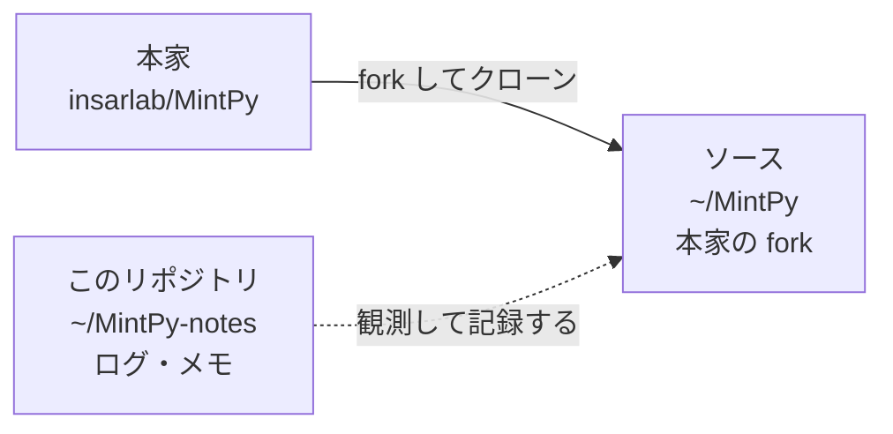

# MintPy-notes

[MintPy](https://github.com/insarlab/MintPy) を触るにあたっての作業ログと調査メモ。

MintPy (Miami INsar Time-series software in PYthon) は InSAR の時系列解析ツール。
ISCE / ARIA / GAMMA / SNAP などが出力した干渉ペアのスタックから、地表変位の時系列と平均速度を推定する。

## このリポジトリについて

- **MintPy の fork ではない。** 本体のソースは一切含まない。純粋にメモ。
- クローン本体は別の場所（`~/MintPy`）に置き、このリポジトリとは混ぜない。
  fork のコードツリーにメモを置くと upstream との差分に混ざり、PR を出すときに邪魔になるため。
- fork の wiki ではなく独立したリポジトリにしてある。fork は消すことがあり、
  消すと wiki も一緒に消えるため。

## 構成

```
README.md              このファイル
CLAUDE.md              Claude Code 用の作業規約
mintpy.code-workspace  VS Code 用。~/MintPy-notes と ~/MintPy を1つのワークスペースにまとめる
docs/
  STATUS.md            現在地・次の一手
  decisions.md         判断の記録（なぜそれを選んだか）
logs/                  日付ごとの作業ログ（追記のみ。過去分は直さない）
reference/             いま現在の事実（環境スナップショット等。上書き更新）
.claude/               Claude Code のサブエージェント定義・トピック別規約
```

| 置き場所 | 何を書くか | 更新の仕方 |
|---|---|---|
| [`logs/`](logs/README.md) | そのとき何が起きたか | 追記のみ |
| [`reference/`](reference/README.md) | いま何が正しいか | 上書き |
| [`docs/STATUS.md`](docs/STATUS.md) | 次に何をするか | 上書き |
| wiki | 概念・用語の解説 | 追記・改訂 |

**用語集・調査メモは wiki に書く** → https://github.com/rindguitar/MintPy-notes/wiki

### 2 つのパスの関係



`~/MintPy` には**このリポジトリのファイルを置かない**。記録はここ（`~/MintPy-notes`）に分けてある。

### 開き方

| 使う版 | 方法 |
|---|---|
| VS Code | `mintpy.code-workspace` を開く |
| ターミナル | `cd ~/MintPy-notes && claude --add-dir ~/MintPy` |

## 運用ルール

- 新しい用語・概念に出会ったら **wiki** に追記する。
  wiki は本体とは別の git リポジトリなので、編集するには clone が要る。
  `git clone https://github.com/rindguitar/MintPy-notes.wiki.git`
- パスは `~/...` で書く。ユーザ名を含む絶対パスは書かない。
- 図は PNG をコミットせず ` ```mermaid ` フェンスで埋め込む。
- コミットメッセージには `feat:` / `fix:` / `docs:` / `refactor:` の接頭辞を付ける。

## 現在の状態

- fork を `~/MintPy` にクローン済み（`origin` = fork、`upstream` = 本家）
- 開発環境は conda 環境 **`mintpy`** に構築済み（fork を editable install、pre-commit 導入済み、単体テスト通過）
  → 詳細は [`reference/environment.md`](reference/environment.md)

## 参考リンク

- upstream: https://github.com/insarlab/MintPy
- fork: https://github.com/rindguitar/MintPy
- 公式ドキュメント: https://mintpy.readthedocs.io/
- 論文: Yunjun, Fattahi & Amelung (2019), *Small baseline InSAR time series analysis: Unwrapping error correction and noise reduction*, Computers & Geosciences 133, 104331. https://doi.org/10.1016/j.cageo.2019.104331
