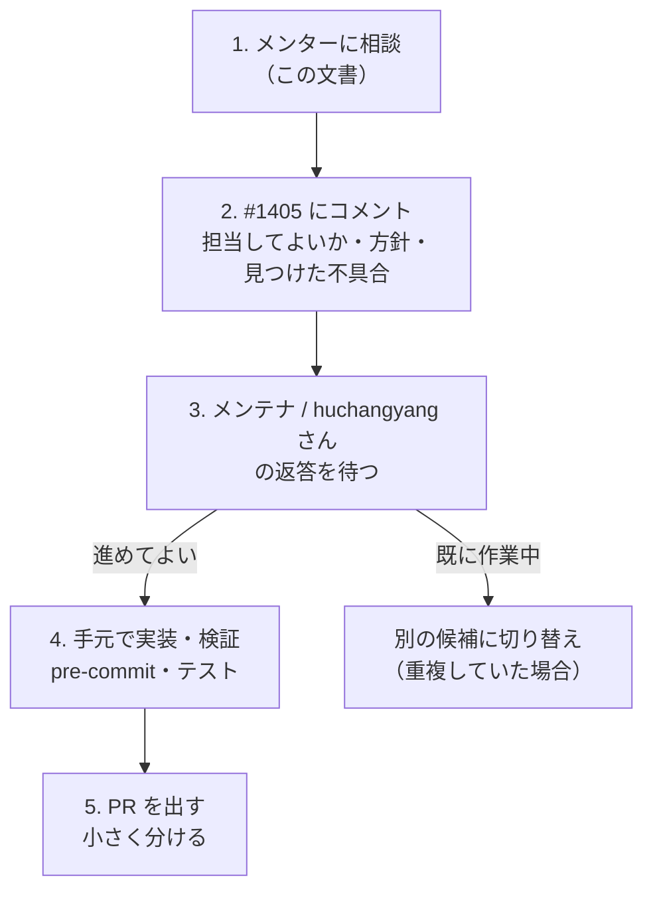

# MintPy へのコントリビュート: 状況報告と相談（2026-10-13）

宛先: メンター
目的: ここまでの状況を共有し、**メンテナに声をかける前に**進め方を相談したい

## 1. 要点

- 開発環境を作り、CI と同じテストが手元で通るところまで来ました
- upstream の open issue（48 件）を調べ、最初の題材として **#1405（コヒーレンス行列の回転表示）** を選びました
- 下調べの途中で、同じスクリプトに**未報告の不具合を 3 件**見つけました
- 次は #1405 に「担当してよいか」をコメントするつもりです。その前に、順番・書き方・PR の分け方について意見をいただきたいです（→ [7. 相談したいこと](#7-相談したいこと)）

## 2. ここまでやったこと

### 開発環境（2026-10-11）

[CONTRIBUTING.md](https://github.com/insarlab/MintPy/blob/main/docs/CONTRIBUTING.md) の手順どおりに構築しました。

- fork を clone し、conda 環境に editable install（ソースを直すと即反映される形）
- `pre-commit` を導入し、全項目 Passed
- CI と同じ単体テストが全件成功。統合テスト（実データで解析を最後まで流す、約 1 分）も PASS

### upstream の issue 調査（2026-10-13）

- open issue は 48 件。メンテナ（主に yunjunz さん）が `pull-request-welcome` ラベルで貢献を求めている issue が 12 件ある
- 外部コントリビュータの PR は、**作成からマージまで中央値 7 日**（直近 17 件）。小さくまとまった PR は早く通る傾向
- 11 件を精読し、候補を 3 件に絞ったうえで #1405 を選びました。残りの候補は手元の記録に残しています

## 3. 取り組みたい issue: #1405

[insarlab/MintPy#1405](https://github.com/insarlab/MintPy/issues/1405)（2025-08-19、yunjunz さん起票、ラベル `enhancement` `pull-request-welcome`、コメントなし）

### 何をする issue か

`plot_coherence_matrix.py` は、1 画素について「どの 2 時期の組（干渉ペア）がどれだけ似ているか（コヒーレンス）」を
行列（縦横が観測日）で表示するツールです。

要望は、この行列を **45° 回転させて対角線を横向きにした表示**を追加することです
（論文 Yunjun et al. 2019 の Fig. 15c と同じ形）。近い日付どうしのペアだけを使う長い時系列では、
行列の大部分が空になり、回転させて対角線付近の帯だけを見るほうが見やすい、という趣旨です。

あわせて「1 枚の図を 2 枚に分ける」ことも書かれていますが、これは **#1493（2026-05、huchangyang さん）で実装済み**です。
残っているのは回転表示だけです。

### 選んだ理由

- メンテナ自身の起票で、`pull-request-welcome` が付いている
- 手元のテストデータで動作を確かめられる（追加のダウンロード不要）
- 回転描画の関数 `utils/plot.py` の `plot_rotate_diag_coherence_matrix()` が既にあり、規模が小さい。
  最初の 1 件として、upstream への PR の流れを一度通すのに向いている

### 気にしている点

**huchangyang さんがこのスクリプトを続けて改良しています**（#1493: 図の分割、2026-05 / #1495: 行列の軸を時間軸に、2026-07）。
どちらの PR も #1405 には触れていませんが、次に回転表示を予定している可能性があります。重複は避けたいです。

### 下調べの結果（手元で確認済み）

- 既存の回転描画関数は、そのままだと**セルがにじんで表示される**（`imshow` に `interpolation='nearest'` が無い）。
  付け足すとくっきり表示されることを確認
- 除外したペアの扱い（上半分に「使用したペア」、下半分に「全ペア」）は、既存の行列表示と見え方が揃っている（意図どおり）
- カラーバー・タイトルが無く、CLI からも呼べない

## 4. 下調べで見つけた不具合（同じスクリプト、いずれも upstream 未報告）

| # | 内容 | いつから | 確認 |
|---|---|---|---|
| A | 画像をクリックして行列を描き直すたびに、**カラーバーが 1 本ずつ増える**（行列表示の 2 方式とも） | 不明（少なくとも現在の版） | 描き直しごとに図の中の軸の数が 2 → 3 → 4 と増えることを確認 |
| B | `--save`（`--nodisplay` で自動的に有効）で**何も保存されない** | 少なくとも 2022-11 以降 | 空のディレクトリで実行し、ファイルが作られないことを確認 |
| C | `--figsize` が**無視される** | 2026-05 の #1493 以降 | #1493 の差分で、このオプションを読む処理が消えたことを確認 |

A は回転表示でも同じ描き直しの処理を通るので、#1405 と一緒に直すのが自然だと考えています。
B と C は #1405 とは独立しています。

## 5. 今後の進め方（案）

実装の方針（メンテナの意向次第で変える）:

1. CLI: `--axis-format` の選択肢を `index` / `time` / `rotate` の 3 つにする（独立した `--rotate` フラグにする案もある）
2. 既存の回転描画関数に `interpolation='nearest'` を足し、ビューア側でタイトルとカラーバーを付ける
3. 不具合 A を直す（描き直しの前に古いカラーバーを消す）
4. 手元のデータで 3 方式すべてを描いて確認し、`pre-commit` を通す

## 6. メンテナへのコメント案（#1405 に投稿予定、英語）

> Hi @yunjunz, I'd like to work on this issue. Since #1493 has already split the viewer into two windows, the remaining part is the rotated style.
>
> My plan:
> 1. Add `rotate` as a third choice of `--axis-format` (`index` / `time` / `rotate`), based on the existing `utils.plot.plot_rotate_diag_coherence_matrix()`. A separate `--rotate` flag would also work, if you prefer.
> 2. Use `interpolation='nearest'` in `plot_rotate_diag_coherence_matrix()`, as the cells are currently blurred, and add a title/colorbar like the other two styles.
>
> While testing the current script, I also found three small issues:
> - Each click in the image window adds one more colorbar to the matrix window (for both `index` and `time`), since `ax.cla()` clears only the matrix axes while `append_axes()` creates a new colorbar axes on every redraw.
> - `--save` (also implied by `--nodisplay`) does not save any figure.
> - `--figsize` is ignored after #1493.
>
> Would you like me to fix them in the same PR, or in a separate one?
>
> @huchangyang, since you have been improving this script (#1493, #1495), please let me know if you are already working on the rotated style, so that we don't overlap.

## 7. 相談したいこと

1. **順番**: 「先にコメントで担当してよいか聞く → 返答を待って実装」で進めるつもりです。
   それとも、小さい変更なので実装して PR の中で説明するほうが MintPy では普通でしょうか
2. **コメントの書き方**: 上の案の内容・長さ・トーンは適切でしょうか。特に huchangyang さんへの声のかけ方
3. **PR の分け方**: 不具合 A〜C を #1405 の PR に含めるか、分けるか。
   メンテナに聞く形にしていますが、こちらから「別 PR にします」と提案したほうがよいでしょうか
4. **題材の選び方**: 最初の 1 件として #1405 は妥当でしょうか。
   他の候補として、`geocode.py` の線形補間がレーダー座標のデータで必ず失敗する件（#215、2019 年から未解決、手元で再現済み）と、
   GAMMA の subset データで `lookup_geo2radar.py` が失敗する件（#850、メンテナが直し方の方針を明示済み）があります

## 8. 参考

- 作業ログ: [環境構築](../logs/2026-10-11-env-setup.md) / [issue 調査](../logs/2026-10-13-upstream-issues.md)
- 不具合の詳細（手元の記録）: [notes #6（カラーバー）](https://github.com/rindguitar/MintPy-notes/issues/6) / [notes #7（`--save` と `--figsize`）](https://github.com/rindguitar/MintPy-notes/issues/7)
- 他の候補: [notes #4（upstream #215）](https://github.com/rindguitar/MintPy-notes/issues/4) / [notes #5（upstream #850）](https://github.com/rindguitar/MintPy-notes/issues/5)
