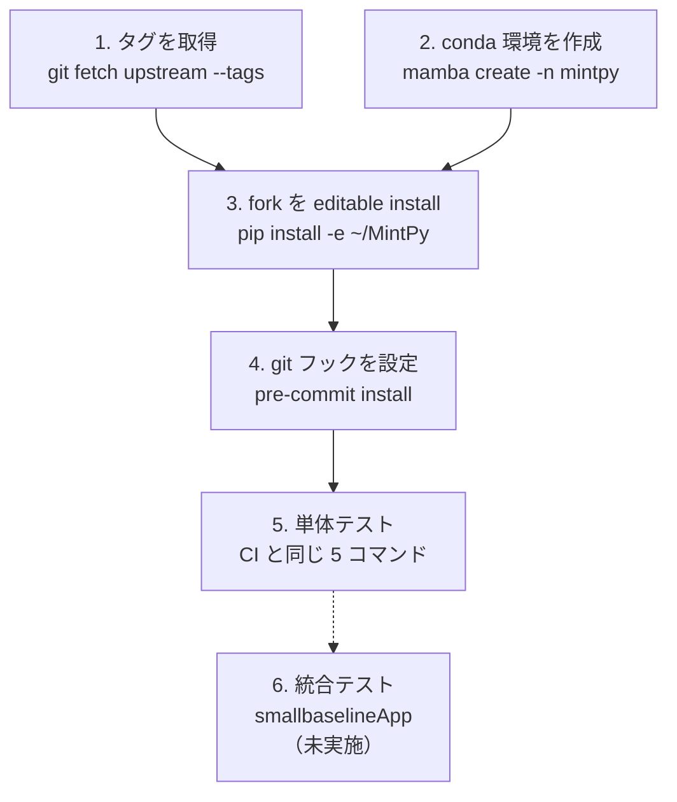

# 2026-10-11 MintPy 開発環境の構築

## 目的

MintPy にコントリビュートするため、upstream の
[`docs/CONTRIBUTING.md`](https://github.com/insarlab/MintPy/blob/main/docs/CONTRIBUTING.md)
と [`docs/installation.md`](https://github.com/insarlab/MintPy/blob/main/docs/installation.md)
の「2. Install the development version」に沿って、fork を編集しながら動かせる環境を作る。

## 結論（先に）

成功。conda 環境 `mintpy` に fork（`~/MintPy`）を editable install し、
**pre-commit 全項目 Passed・CI と同じ単体テスト全件成功**。`~/MintPy` の作業ツリーは汚れていない。

```
mintpy 1.6.4.post3  (Python 3.14.8)
~/MintPy/src/mintpy/__init__.py
```

詰まった点は無いが、記録しておくべき発見が 3 つある（後述）。

- fork にタグが無く、そのままだと**バージョン番号が壊れる**
- `fsspec[http]` の extra を conda が無視し、`aiohttp` 系だけ **pip から入った**
- CONTRIBUTING.md の `git pull upstream/main` は**そのままでは動かない**

## 前提環境

| 項目 | 値 |
|---|---|
| OS | WSL2 (Ubuntu 24.04.2 LTS, kernel 5.15 microsoft-standard-WSL2) |
| CPU / メモリ | 8 コア / 15 GB |
| conda | Miniforge / conda 26.7.2 / mamba 2.5.0 / `~/miniforge3`（isce3 と共用） |
| 既存の環境 | `base`, `isce3`（どちらにも mintpy は入っていない） |
| クローン | `~/MintPy`（`origin` = fork、`upstream` = 本家、branch `main`） |
| HEAD | `9e0d46b2`（`upstream/main` と一致） |

## 手順の全体像



1 と 2 は独立だが、**3 より前に 1 が済んでいる必要がある**（理由は「発見 1」）。

## 1. タグの取得

```bash
cd ~/MintPy
git fetch upstream --tags
```

クローン直後は `git tag` が空だった。fork 側（`origin`）のタグが 0 件、本家は 37 件。
fork を作るときに GitHub の既定「Copy the `main` branch only」が有効だったためと推定。
取得後は `git describe --tags` → `v1.6.4-3-g9e0d46b2`。

## 2. conda 環境の作成

installation.md は `mamba create --name insar --file requirements.txt` を例示している。
環境名は isce3 と揃えて**プロジェクト名 `mintpy`** にし、CI（`.circleci/config.yml`）が
追加しているものと `tests/requirements.txt` の開発用を足した。

```bash
mamba create --yes --name mintpy -c conda-forge \
    --file ~/MintPy/requirements.txt \
    gdal libgdal-netcdf pre-commit pyfftw pytest setuptools_scm
```

- `isce2` は入れない（ISCE-2 の出力を自分で処理する予定がないため。CI も入れていない）
- 360 パッケージ / ダウンロード 277 MB / **所要 5 分 39 秒**（大半は依存解決）
- 警告・競合なし

## 3. editable install

```bash
mamba run -n mintpy python -m pip install -e ~/MintPy
```

- `site-packages` に入るのは `__editable__.mintpy-1.6.4.post3.pth`（中身は `~/MintPy/src` の 1 行）と `dist-info` だけ。
  ソースを書き換えると即反映される
- `~/MintPy/src/mintpy.egg-info/` が生成されるが `.gitignore` 済み
- CI と同じ動作確認（`smallbaselineApp.py -h` / `tropo_pyaps3.py -h` / `solid_earth_tides.py -h`）はすべて OK

## 4. pre-commit

```bash
cd ~/MintPy
mamba run -n mintpy pre-commit install
mamba run -n mintpy pre-commit run --all-files
```

- 14 フック中 13 Passed、`check json` は対象なしで Skipped。所要 16 秒（初回はフック環境の構築込み）
- `.git/hooks/pre-commit` には `INSTALL_PYTHON=~/miniforge3/envs/mintpy/bin/python3.14` が書き込まれる。
  **環境を activate していなくても `git commit` でフックが動く**
- システムにも `/usr/bin/pre-commit`（3.6.2）があるが、使っているのは環境内の 4.6.2

## 5. 単体テスト（CI の "Unit Test" ステップと同じ）

| コマンド | 結果 | 所要 |
|---|---|---|
| `tests/objects/euler_pole.py` | OK | 1 秒未満 |
| `tests/objects/ionex.py` | OK | 約 2 秒 |
| `tests/asc_desc2horz_vert.py` | OK | 約 1 秒 |
| `tests/dem_error.py` | OK | 約 1 秒 |
| `pytest tests/` | **4 passed**, 0 failed, 0 warnings | 0.2 秒 |

ネットワークアクセスなし（`tests/data/` のローカルファイルのみ）。実行後も `git status` は空。

## 6. 統合テスト（未実施）

CONTRIBUTING.md の「overall test」。テストデータのダウンロードを伴い約 15 分かかるため、
今回は実行していない。CI では 6 データセットを順に回している。

```bash
mkdir -p ~/data
mamba run -n mintpy python ~/MintPy/tests/smallbaselineApp.py --dir ~/data --dset FernandinaSenDT128
```

## 発見

### 発見 1: タグが無いとバージョン番号が壊れる（しかも 2 通りに）

MintPy のバージョンは 2 か所で別々に決まる。

| どこで | 仕組み | タグあり | **タグなし**（`git clone --no-tags` で実測） |
|---|---|---|---|
| pip install 時（`dist-info` に記録） | setuptools_scm | `1.6.4.post3` | **`0.0.post2780`** |
| import 時（`mintpy.__version__`） | `version.py` が `git describe --tags` を直接実行 | `1.6.4.post3` | **`1.6.4`**（失敗を bare `except` で握りつぶし、ハードコードの最新リリースを返す） |

タグなしだと、パッケージとしては `0.0.post2780`、プログラム上は `1.6.4` と**食い違ったまま気づかない**。
バグ報告にバージョンを書くときに誤情報になる。→ 仕組みは wiki
[setuptools_scm](https://github.com/rindguitar/MintPy-notes/wiki/Setuptools-SCM)

### 発見 2: `fsspec[http]` の extra は conda では無視される

`requirements.txt` の `fsspec[http]` を `mamba --file` で読むと、`fsspec` 本体だけが入り、
`[http]` が要求する `aiohttp` 系は入らない。その後の `pip install -e` が不足分を検出し、
**`aiohttp` / `aiosignal` / `frozenlist` / `multidict` / `yarl` / `propcache` / `aiohappyeyeballs` を PyPI から入れた。**
CI も同じ手順なので同じことが起きているはず。実害は今のところ無いが、conda と pip の混在点として覚えておく。

### 発見 3: CONTRIBUTING.md の `git pull upstream/main` は動かない

「2. Develop your contribution」に書かれているコマンドをそのまま打つと失敗する。

```
$ git pull upstream/main
fatal: 'upstream/main' does not appear to be a git repository
```

`git pull` の第 1 引数はリモート名なので、正しくは `git pull upstream main`（スペース区切り）。
upstream の issue / PR を `git pull upstream` / `pull upstream main` で検索してヒットなし（未報告）。
CONTRIBUTING.md の最終更新は 2023-09-09（#1087）。**最初のコントリビュート（ドキュメント修正）の候補。**

### その他

- Python は **3.14.8** が入った（`requirements.txt` に上限なし、`requires-python = ">=3.8"`）。
  CI も最新を拾うので条件は同じだが、新しすぎる版で問題が出たら最初に疑う
- 主要な版は [`reference/environment.md`](../reference/environment.md) にまとめた

## 追記: 統合テストの結果（同日、ユーザーが手動で実行）

```bash
mamba run -n mintpy python ~/MintPy/tests/smallbaselineApp.py --dir ~/data --dset FernandinaSenDT128
```

**PASS**（`PASS testing of smallbaselineApp on dataset 1/1: FernandinaSenDT128 - ISCE2/topsStack`）。

### 所要時間の内訳

ターミナル出力の前半はスクロールで失われたため、生成ファイルのタイムスタンプから再構成した
（tar の作成時刻 = ダウンロード開始、最終更新時刻 = 終了。展開ファイルの作成時刻 = 展開時刻。出力ファイルの更新時刻 = 各ステップ）。

| 区間 | 時刻 | 所要 |
|---|---|---|
| テスト開始（`~/data` 作成） | 15:51:21 | — |
| ダウンロード `FernandinaSenDT128.tar.xz` 277 MB（Zenodo） | 15:51:23 → 15:58:44 | **7 分 21 秒**（約 0.63 MB/s） |
| 展開（2,333 ファイル） | 15:58:44 → 15:58:56 | 12 秒 |
| `smallbaselineApp.py`: 読み込み〜逆解析〜補正〜速度推定〜geocode〜HDF-EOS5 保存 | 15:58:56 → 15:59:32 | 約 36 秒 |
| `smallbaselineApp.py`: 図の出力（plot ステップ） | 15:59:32 → 15:59:52 | 約 20 秒 |
| `view.py` で速度マップを描画 → PASS | 15:59:54 | 2 秒 |
| **合計** | | **約 8 分 33 秒**（うち 86 % がダウンロード） |

- `smallbaselineApp.py` 自身の表示 `Time used: 00 mins 56.4 secs` と、上の 36 + 20 秒は一致する
- ディスク使用量: 展開後 1.2 GB + tar 277 MB（`~/data/` 配下）
- `~/MintPy` の作業ツリーは汚れていない

CONTRIBUTING.md の「約 15 分」より短い。**律速はダウンロード速度で、計算は 1 分弱。**
2 回目以降は tar が残っていればダウンロードを飛ばす（`tar file exists, skip re-downloading.`）ので 1 分強で終わる。
なお **`--dset` を省略すると既定は `all`**（7 データセット、合計約 1.8 GB をダウンロード）になる。

### 「PASS」が保証する範囲

`tests/smallbaselineApp.py` を読んだ結果、PASS の条件は次の 2 つだけ。

1. `smallbaselineApp.py <config>` の終了コードが 0
2. 速度マップ（`geo/geo_velocity.h5`）を `view.py` で PNG に描けた

**数値を基準値と照合する処理は無い。** 全データセット通過時の文言も `PASS ALL testings without running errors.`。
結果の妥当性は出力を見て判断するしかない。

- `pic/geo_velocity.png` を目視: カルデラ内に衛星方向（LOS）の正の速度（最大 +3 cm/年程度）が集中し、
  島の他の部分はほぼ 0。白抜きはコヒーレンスが低くマスクされた領域。火山の膨張として妥当な見た目
- 対流圏補正（`ERA5`）は tar に同梱の `inputs/ERA5.h5` を使う。既定（`--test-pyaps` なし）では
  ERA5 のダウンロード（CDS アカウントが必要）は試験されない

## 追記: 統合テストの再実行（出力を保存）と警告の調査

1 回目はターミナル出力の前半が失われたため、全出力をファイルに残して再実行した（Claude Code の test-runner が実行）。
tar が残っているのでダウンロードは飛ばされる（`tar file exists, skip re-downloading.` を確認）。

```bash
cd ~/data && PYTHONUNBUFFERED=1 mamba run -n mintpy python ~/MintPy/tests/smallbaselineApp.py \
    --dir ~/data --dset FernandinaSenDT128 > ~/data/smallbaselineApp.log 2>&1
```

- **PASS**（exit 0）。壁時計 67 秒（展開込み）、`Time used: 00 mins 53.8 secs`
- ログ: `~/data/smallbaselineApp.log`（1262 行）。`Error` / `Traceback` は無し。`~/MintPy` の作業ツリーも汚れていない

### 出た警告

| # | 種類 | 発生元 | 内容 |
|---|---|---|---|
| 1 | MintPy の `WARNING` × 2 | `load_data` | 電離層スタック（`unwrapPhase`）とオフセットスタック（`rangeOffset` / `azimuthOffset`）のファイルが無いので読み込みを飛ばす。テストデータに含まれないだけで**想定内** |
| 2 | `RuntimeWarning: bool is used as a file descriptor` | `src/mintpy/utils/utils1.py:384`（呼び出し元 `reference_point.py:49`） | 下記 A。**潜在バグ** |
| 3 | `FutureWarning`（scikit-image 0.26.0） | `src/mintpy/objects/conncomp.py:47` | 下記 B |
| 4 | `H5pyDeprecationWarning`（h5py 3.16.0） | `src/mintpy/unwrap_error_phase_closure.py:342` | 下記 C |

2〜4 は、Python・ライブラリが新しくなって非推奨になった書き方が MintPy に残っているもの。
upstream の issue / PR を検索した範囲では**いずれも未報告・未修正**
（PR #1504 "fix interactive plot bug and various warnings"（2026-07 マージ）も、この 3 ファイルには触れていない）。

#### A. `os.path.isfile(False)` が呼ばれている

```python
# reference_point.py:49
stack = ut.temporal_average(inps.file, datasetName=ds_name, updateMode=True, outFile=False)[0]

# utils/utils1.py: temporal_average()
if outFile is None:          # False は None ではないので素通りし、outFile = False のまま
    ...                      # 既定のファイル名を決める
if updateMode and os.path.isfile(outFile):   # ← os.path.isfile(False)
    dataMean = readfile.read(outFile)[0]
```

`os.path.isfile(False)` は bool を整数 0 とみなし、**ファイル記述子 0（標準入力）を stat する**。
普段は標準入力が端末なので `False` が返って実害が無いが、標準入力が通常ファイルにリダイレクトされていると
`True` になり、`readfile.read(False)` に進んでしまう。`python -c "import os; os.path.isfile(False)"` で同じ警告を再現できる。

#### B. `remove_small_objects(min_size=...)` の非推奨

scikit-image 0.26.0 で `min_size` が非推奨になり `max_size` へ移行。**しきい値の意味が「未満を消す」→「以下を消す」に変わる**ので、
単純な置き換えでは結果が 1 ピクセル分ずれる。`requirements.txt` は `scikit-image`（版指定なし）なので、古い版との両立も要る。

#### C. dtype 無しの `create_dataset`

h5py 3.16 で、data も dtype も渡さない `create_dataset` が非推奨。現状の既定は `f4`（float32）。
同じパターンが `unwrap_error_bridging.py:127` にもある（今回のテストでは通らないので警告は出ていない）。
他の `create_dataset` はすべて data か dtype を渡している。
