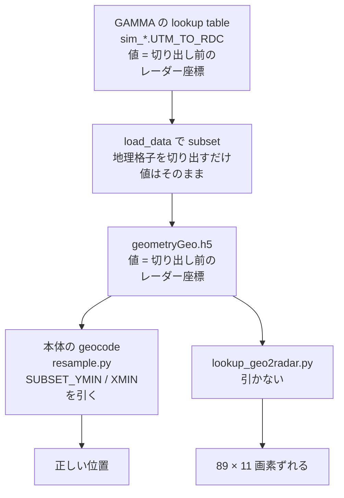

# 2026-10-13 upstream #850 を再現し、原因を特定した

## 目的

upstream [#850](https://github.com/insarlab/MintPy/issues/850)（2022-09、yunjunz 起票）
「GAMMA の subset データで `lookup_geo2radar.py` が失敗する」を手元で再現し、直し方を決める。notes #5。

## 結論（先に）

- issue の手順では**もう落ちない。しかし結果が黙ってずれている。**
  subset されたデータでは、レーダー座標の緯度経度が**レンジ方向 89 画素・アジマス方向 11 画素ずれた位置**に書き込まれる
- 原因は 2022 年にスクリプト作者が指摘したとおり「subset 非対応」のまま。
  地理座標の lookup table の値は**切り出し前のレーダー格子の座標**だが、`lookup_geo2radar.py` はそれを切り出し後の格子の座標として使っている
- 直し方の手本は本体の geocode（`src/mintpy/objects/resample.py`）にある。
  レーダー側のファイルの `SUBSET_YMIN` / `SUBSET_XMIN` を lookup の値から引く
- 2022 年に落ちたのは、当時は値が 100 から始まり、最初の小区画に点が 1 つも入らなかったため（推定）。
  今のテストデータでは値が 33.9 から始まるので、落ちずにずれた結果が出る

## 準備: WellsEnvD2T399 の統合テスト（ユーザーが実行）

```bash
mamba run -n mintpy python ~/MintPy/tests/smallbaselineApp.py --dir ~/data --dset WellsEnvD2T399 2>&1 | tee ~/data/smallbaselineApp-WellsEnvD2T399.log
```

**PASS**。ダウンロード 280 MB に 15 分 2 秒（約 0.31 MB/s）、`smallbaselineApp.py` 本体は 25.5 秒。
警告は FernandinaSenDT128 と同じ想定内の 2 件（電離層・オフセットのスタックが無い）のみ。

テスト設定 `tests/configs/WellsEnvD2T399.txt` は `mintpy.subset.lalo = 41.02:41.32, -115.10:-114.65` で、
読み込みの段階でレーダー側と地理側の両方を切り出している。

| ファイル | 座標 | 大きさ | subset の属性 |
|---|---|---|---|
| `inputs/ifgramStack.h5` / `inputs/geometryRadar.h5` | レーダー | 257 × 254（元は 1558 × 1292 相当） | `SUBSET_XMIN=89`, `SUBSET_YMIN=11` |
| `inputs/geometryGeo.h5`（lookup table） | 地理 | 763 × 544（元は 2728 × 1870） | `SUBSET_XMIN=371`, `SUBSET_YMIN=158`（地理格子の画素） |

`geometryGeo.h5` の値: `rangeCoord` 33.9〜402.5、`azimuthCoord` −48.2〜324.7。

## 再現

`geometryRadar.h5` のコピーに対して issue の手順を実行（データは書き換えない）。

```bash
cp ~/data/WellsEnvD2T399/mintpy/inputs/geometryRadar.h5 <作業ディレクトリ>/
lookup_geo2radar.py ~/data/WellsEnvD2T399/mintpy/inputs/geometryGeo.h5 -w <作業ディレクトリ>/geometryRadar.h5
```

- 終了コード 0。`latitude` / `longitude` が追加され、既存の `height` などは残る
- `latitude` の 17.5 %（65,278 画素中 11,428）が NaN

## 正しさの確認

### 往復チェック（← 循環しており、ずれは検出できなかった）

地理画素 → lookup table → レーダー画素 → 書き込まれた緯度経度、と往復させると元に戻った（中央値 58 m）。
しかしこれは、**lookup の値をそのまま格子の番号として使っている限り必ず一致する**ので、ずれの検査になっていなかった。
一度「正しく動いている」と判断したが撤回した。

### 標高による独立チェック

本体の geocode が作った地理座標の標高（`geo/geo_geometryRadar.h5`。geocode は subset のずれを補正している）を基準にした。
`lookup_geo2radar.py` が書いた緯度経度で地理座標の標高を引き、同じ画素のレーダー座標の標高（`inputs/geometryRadar.h5` の `height`、1653〜3228 m）と比べる。

| 比べ方 | 画素数 | 標高差の中央値 | 95 パーセンタイル |
|---|---|---|---|
| 書き込まれたまま | 40,299 | **115.2 m** | 418.4 m |
| (11, 89) 画素ずれていると仮定して比べる | 40,151 | **2.6 m** | 31.1 m |

→ **書き込まれた緯度経度は、ちょうど subset の開始位置の分だけずれている。**

## 原因



- MintPy には、subset のときに lookup の値そのものをずらす処理は無い（`load_data.py` / `objects/stackDict.py` / `subset.py` を確認。値はマルチルックの倍率で割るだけ）
- 本体の geocode は、使うときにずらしている（`src/mintpy/objects/resample.py` の `prepare_geometry_definition_geo()`）:

  ```python
  if 'SUBSET_XMIN' in self.src_meta.keys():
      dest_y[dest_y != 0.] -= float(self.src_meta['SUBSET_YMIN'])
      dest_x[dest_x != 0.] -= float(self.src_meta['SUBSET_XMIN'])
  ```

- `lookup_geo2radar.py` は、レーダー格子の大きさを `-w` のファイル（切り出し後、257 × 254）から取る一方、
  補間の点の座標には lookup の値（切り出し前）をそのまま使う。切り出し後の格子 0〜257 を切り出し前の 0〜257 として扱ってしまう

## 修正の方針（案）

1. `-w` のファイルに `SUBSET_XMIN` / `SUBSET_YMIN` があれば、`rangeCoord` / `azimuthCoord` の 0 でない値から引く（`resample.py` と同じ）
2. メンテナの依頼どおり、`tqdm` を `mintpy.utils.ptime.progressBar` に置き換える（`prep_fringe.py` などに使用例あり）
3. 検証: 修正後に上の標高チェックを「書き込まれたまま」で行い、中央値が数 m になることを確認。pre-commit と単体テストも通す

メンテナの方針（2022-10-11）は「subset に対応するか、非対応のメッセージを出すか」。原因が分かり、直し方も本体に前例があるので、**対応する**ほうを選べる。

## その他の観察

- `-w` を省略すると、既定値 `./geometryRadar.h5` を探して `FileNotFoundError` で止まる（分かりやすく、問題なし）
- `run_lookup_geo2radar()` の `inps.reference` の分岐は CLI にそのオプションが無いので到達しない（死んだコード）
- 地理格子の緯度経度を画素の角（`Y_FIRST + i * Y_STEP`）で計算している。本体の geocode は画素の中心を使う。差は半画素（約 46 m）で、今回の修正の範囲外
