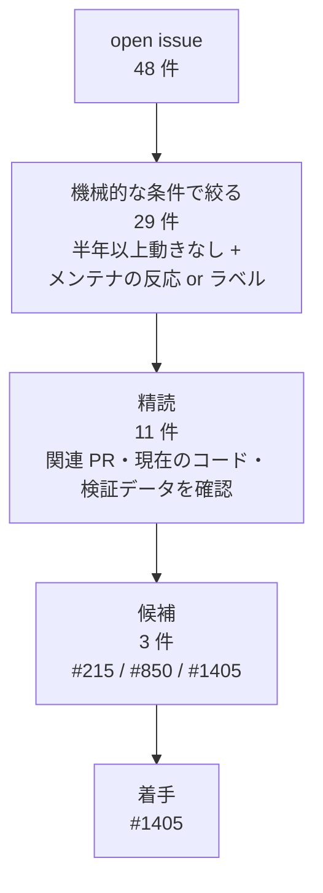

# 2026-10-13 upstream の open issue を調査した

## 目的

insarlab/MintPy の open issue を一覧・分類し、**放置されていて取り掛かりやすいもの**を選ぶ。
方針は 2026-10-11 に決めた「内容に踏み込んだもの・既存 issue への貢献を優先」（`docs/decisions.md`）。

## 結論（先に）

- open issue は **48 件**と少ない。外部コントリビュータの PR は**中央値 7 日でマージ**され、メンテナ（yunjunz）の反応は早い。
  isce3（PR が数か月〜1 年滞留）とは状況が違い、**小さくまとまった PR なら通る見込みが高い**
- 11 件を精読し、候補を 3 件に絞った（#215 / #850 / #1405）
- **着手先は #1405**（`plot_coherence_matrix.py` に回転表示を追加）。小さく始めて upstream への PR の流れを一度通す
- 残り 2 件は notes の Issue に分析結果ごと残した（#215 → notes #4、#850 → notes #5）

## 調査方法

`gh api` を直接使う（isce3 と同じく `gh issue view` は Projects classic の廃止で落ちることがある）。
search エンドポイントはレート制限が厳しいので、一覧は REST の issues / comments から取った。

```bash
gh api --paginate "repos/insarlab/MintPy/issues?state=open&per_page=100"   # PR も混ざるので pull_request キーで除外
gh api repos/insarlab/MintPy/issues/<n>/comments
gh api --paginate repos/insarlab/MintPy/issues/<n>/timeline               # cross-referenced で関連 PR を拾う
```

一覧の取得・集計と 11 件の精読は explorer サブエージェント（haiku）に任せ、候補の判断と
主要な主張の裏取り（#215 の再現、#850 のコメント、#1405 の関連 PR）は本体で行った。

## 絞り込みの流れ



機械的な条件だけでは拾えないもの（#1485 は最終更新が新しく条件外）を、全 48 件を目で見て精読に足した。

## 全体像

| 項目 | 値 |
|---|---|
| open issue | 48 件 |
| ラベル（重複あり） | なし 24 / enhancement 12 / **pull-request-welcome 12** / to-do list 7 / bug 5 / good-first-issue 4 / discussion 3 |
| 作成年 | 2019: 4 / 2020: 3 / 2021: 6 / 2022: 4 / 2023: 5 / 2024: 8 / 2025: 10 / 2026: 8 |
| メンテナの反応 | あり 21 / 起票者がメンテナ 11 / **一度も反応なし 16** |
| コメントしているメンテナ | yunjunz 50 / jhkennedy 7 / forrestfwilliams 3 / avalentino 2 / hfattahi 2 |
| open PR | 22 件（最古は #792、2022-06） |
| 直近 1 年に close された issue | 15 件 |

`pull-request-welcome` ラベルがあり、**メンテナが貢献を求めている issue が明示されている**のは isce3 との大きな違い。

### PR はすぐマージされる（小さければ）

直近の外部コントリビュータの PR（bot とメンテナ本人を除く）。作成からマージまでの日数:

| PR | 作者 | 日数 |
|---|---|---|
| #1517 | s-sasaki-earthsea-wizard | 1 |
| #1455 / #1508 / #1493 / #1495 | huchangyang | 0 / 1 / 4 / 46 |
| #1501 / #1479 | teinori | 14 / 4 |
| #1483 / #1474 / #1465 / #1464 | sssangha | 1 / 5 / 7 / 12 |
| #1487 | ehavazli | 16 |
| #1469 / #1463 / #1456 | 他 | 1 / 13 / 28 |
| #1486 | dbekaert | 100 |
| #1328 | ehavazli | 314 |

17 件の中央値は **7 日**。長いもの（#1486, #1328）は規模が大きい。
一方で 2022〜2023 年の大きめの PR（#792 prep_hyp3_crop、#1073 CF 準拠など）は open のまま残っている。
→ **小さく分けて出す**のが通りやすい。

## 精読した 11 件

| issue | 内容 | 結果 | 判断 |
|---|---|---|---|
| **#215** | `geocode.py` の線形補間が失敗（2019） | **手元で再現**。ISCE 系（レーダー座標の lookup table）では `-i linear` が必ず落ちる | **候補** → notes #4 |
| **#850** | GAMMA の subset データで `lookup_geo2radar.py` が失敗（2022、メンテナ起票） | 原因は特定済み（`rangeCoord` が 100 始まり）。メンテナが「subset 対応 or 非対応メッセージ」「tqdm を progressBar に」と方針を明示 | **候補** → notes #5 |
| **#1405** | `plot_coherence_matrix.py` に回転表示（2025-08、メンテナ起票、PR 歓迎） | 描画関数 `plot_rotate_diag_coherence_matrix` は `utils/plot.py` に既にあるが CLI から使えない。「図を 2 枚に分割」の部分は #1493 で実装済み | **候補 → 着手** |
| #1045 | `view.py` に `--subset-lalo` | 未実装。承認済みだが CLI の引数処理だけ | 内容が浅い |
| #844 | `save_kmz_timeseries.py` の表示単位 | 未実装（cm 固定）。承認済み | 内容が浅い |
| #669 | UTM データで参照点を lat/lon 指定 | **既に実装済みの可能性が高い**（`reference_point.py` / `coord.py` に UTM 変換あり） | HyP3 データで確認して close を提案できる |
| #1299 | 4D データの geocode | PR #1457 が "Fix #1299" で open のまま（2026-02 以降停止。メンテナがテスト用ファイルを依頼） | 対象外 |
| #1485 | NISAR GUNW に `slantRange` が無い | **解決済み**（PR #1487）。2026-07 に第三者が close 可能とコメント済み | 対象外 |
| #664 / #1265 | GACOS と HyP3（UTM 座標）で対流圏補正が失敗 | 同じ根本原因。メンテナが修正案を 2 つ提示済み | 内容は深いが **GACOS のデータが手動申請** |
| #226 | PyAPS の CDS 認証エラーを分かりやすく | 元の ZeroDivisionError は PR #1417 で解消。認証エラーが bare `except` で隠れる点が残る | 実動作の確認に CDS アカウントが要る |

## 候補 3 件の比較

| issue | 放置 | 手元で検証 | 踏み込みの深さ | 規模 |
|---|---|---|---|---|
| #215 | 2019〜。メンテナが "linear interpolation is not finished" と認める | **再現済み**（手元のデータ、DL 不要） | 深い（リサンプリング・出力格子の定義） | 中（設計判断あり） |
| #850 | 2022〜。方針明示済み | WellsEnvD2T399（280 MB の DL が要る） | 中（lookup table の座標オフセット） | 小〜中 |
| #1405 | 2025-08〜 | 手元のデータで可能 | 浅〜中（関数は既存。配線が主） | 小 |

ユーザーの判断で **#1405** に決定。小さく始めて、upstream への PR の流れ（issue でのやりとり → PR → レビュー）を一度通す。

## #1405 について分かっていること

- 要望（yunjunz, 2025-08-19）: Yunjun et al. (2019) Fig. 15c のような**回転表示**を追加し、長い時系列の逐次ネットワークを見やすくする。
  あわせて、1 枚の図を `tsview.py` のように 2 枚に分ける
- 2 枚への分割は **#1493（huchangyang、2026-05 マージ）で実装済み**。続く #1495（同、2026-07 マージ）で行列の軸が時間軸になった
- **huchangyang さんがこのスクリプトを継続的に改良している。** どちらの PR も #1405 に言及していないので、
  着手前に issue で「回転表示を担当してよいか」をひと言確認する
- 回転描画の関数 `src/mintpy/utils/plot.py` の `plot_rotate_diag_coherence_matrix`（`rotate_deg=-45`, `Affine2D`）は既にある。
  ただし `src/` の中から呼ばれておらず、CLI にも回転オプションが無い

## 次回への申し送り

- #1405: 現在の `plot_coherence_matrix.py`（#1493 / #1495 適用後）の構造を読み、回転表示をどこにどう足すかの方針を作る
- 進め方: **issue に着手表明と方針をコメント → 反応を見て PR**（PR は小さく）
- `gh issue view` は使わず `gh api` を使う

## 追記: #1405 の下調べと、メンターへの相談

### 下調べ（手元のデータで確認。`~/MintPy` には書き込んでいない）

FernandinaSenDT128 の基準点の画素で、既存の 3 種類の行列表示（index / time / 回転）を並べて描いた。

- 既存の回転描画関数 `plot_rotate_diag_coherence_matrix()` は、`imshow` に `interpolation='nearest'` が無く**セルがにじむ**。足すとくっきりする
- 除外ペアを「下三角」に置いているのは意図どおり。−45° 回転で下三角が画面の上側に来るので、
  index 表示と同じく「上 = 使用したペア、下 = 全ペア」に見える（仮の除外リストを与えて確認）
- 試作で 3 つの図に同じカラーマップのオブジェクトを使い回したら、time 表示の関数が呼ぶ `cmap.set_bad('white')` が
  他の図にも効いて対角線が白く抜けた。実際のビューアは 1 種類しか描かないので問題にならないが、**カラーマップを書き換える副作用がある**

### 同じスクリプトで見つかった不具合（いずれも upstream 未報告）

| 内容 | 確認方法 | 記録 |
|---|---|---|
| 描き直すたびにカラーバーが 1 本ずつ増える（index / time とも） | 描き直しごとに行列ウィンドウの軸の数を数えた → `[2, 3, 4]` | notes #6 |
| `--save` / `--nodisplay` で何も保存されない | 空のディレクトリで実行 → 終了コード 0、ファイル無し。少なくとも 2022-11 以降ビューアに保存処理が無い | notes #7 |
| `--figsize` が無視される | #1493（`6ba3312d`）の差分で `fig_size` を読む処理が消えている | notes #7 |

`tsview.py` には画像ウィンドウ用の `--figsize-img`（#1059）があり、2 枚の図のサイズを分ける前例になる。

### 進め方の変更

当初は「#1405 にコメント → PR」のつもりだったが、**メンテナに声をかける前にメンターに相談する**ことにした。
相談用の文書: [`drafts/2026-10-13-mentor-report.md`](../drafts/2026-10-13-mentor-report.md)
（状況・#1405 を選んだ理由・見つけた不具合・進め方の案・メンテナへのコメント案・相談したいこと 4 点）

## 追記: #1405 を保留し、#850 に切り替えた

- #1405 は保留。huchangyang さんとの重複の可能性があり、機能追加で内容への踏み込みも浅め。
  ここまでの下調べ・実装方針・upstream へのコメント案は **notes #8** にまとめた（upstream には未投稿）
- 着手先は **#850**（notes #5）。メンターへの相談は取りやめ、相談用の文書（`drafts/`）は削除した
- #850 を選んだ理由: メンテナ自身の起票で直し方の方針が明示済み、3 年間誰も手を付けておらず重複の心配がない、
  実際に落ちる不具合で lookup table の座標オフセットという内容に踏み込める
- 再現には GAMMA のテストデータ WellsEnvD2T399（280 MB）が要る（ダウンロードはユーザーが実行）
