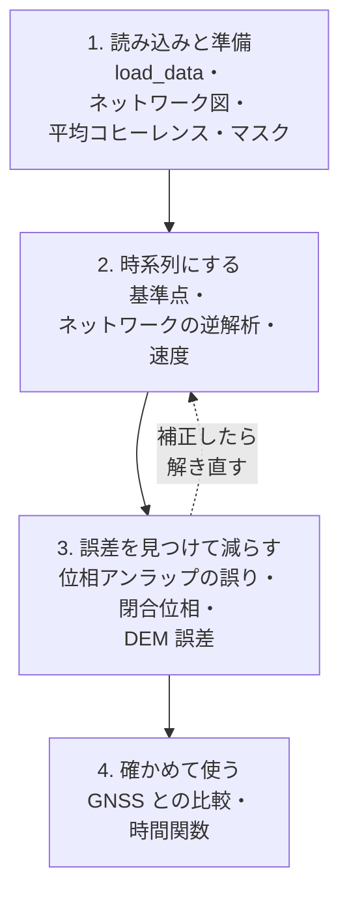

# 2026-10-25 公式チュートリアル（ARIA 版）の振り返り

## 目的

MintPy の公式チュートリアル `~/MintPy-tutorial/workflows/smallbaselineApp_aria.ipynb` を全セル実行した（ユーザーが実行）。
メンターの助言どおり、#850 に戻る前に `smallbaselineApp.py` の各ステップが**何をしているか**を理解する。
このログは、各ステップの「入力 → 何をしているか → 出力」と、**今回の実行で実際に出た数字**をまとめたもの。

## 結論（先に）

- 全セルが正常に終わった（エラーなし、処理は約 10 分）。結果は `~/data/test/SanFranSenDT42/mintpy/`
- 流れは 4 段: **読み込みと準備 → 時系列にする → 誤差を見つけて減らす → 確かめて使う**。誤差を補正したら時系列を解き直す
- サンフランシスコ湾岸の地表は、基準点に対して**中央値 −2.1 mm/年**（衛星から遠ざかる向き）。強いところで −13.7 mm/年
- GNSS（衛星測位）と比べた速度の誤差は **RMSE 1.7 mm/年**
- **このデータは最初から地理座標**なので、ジオコーディングもルックアップテーブルも出てこない。#850 に関わるレーダー座標の話は、別のノートブック（`applications/coord_conversion.ipynb`）で補う

## データ

| 項目 | 値 |
|---|---|
| 地域・衛星 | サンフランシスコ湾岸 / Sentinel-1、下降軌道 42 |
| 入力 | ARIA の干渉画像プロダクト（GUNW）。**最初から地理座標**（緯度経度の格子） |
| 撮影 | **189 回**（2015-03-01 〜 2022-06-04） |
| 干渉画像 | **961 枚**（除外 0）。撮影日の間隔は 6〜456 日、中央値 36 日 |
| 画像の大きさ | 1021 × 1021 画素、1 画素 0.000833°（南北に約 90 m） |
| 設定 | `SanFranSenDT42.txt`（ノートブックが書き出す）。基準点 37.69, −122.07。対流圏補正・傾き除去はなし、DEM 誤差の補正と位相アンラップの誤りの補正（bridging）はあり |

## 処理の流れ



### 1. 読み込みと準備（ノートブックの 2.1〜2.3）

| ステップ | コマンド | 入力 → 出力 | 何をしているか | 今回の結果 |
|---|---|---|---|---|
| 読み込み | `smallbaselineApp.py --dostep load_data` | ARIA のファイル群 → `inputs/ifgramStack.h5`、`inputs/geometryGeo.h5` | 干渉画像の束と、地形の情報（標高・入射角・方位角・斜距離・水域）を MintPy の [HDF5](https://github.com/rindguitar/MintPy-notes/wiki/HDF5) にまとめる | 961 枚 × 1021 × 1021 |
| ネットワーク図 | `plot_network.py` | `ifgramStack.h5` → 図 | どの撮影日どうしで干渉画像を作ったか（ペアの組み方）を見る | 間隔 6〜456 日 |
| 平均コヒーレンス | `temporal_average.py -d coherence` | → `avgSpatialCoh.h5` | 全干渉画像の[コヒーレンス](https://github.com/rindguitar/MintPy-notes/wiki/Coherence)を平均し、安定して測れる場所を見る | |
| マスク | `generate_mask.py` | → `waterMask.h5`、`maskConnComp.h5` | 水域や、位相のつながりが切れる場所を除く目印を作る | |

### 2. 時系列にする（2.4〜2.6）

| ステップ | コマンド | 入力 → 出力 | 何をしているか | 今回の結果 |
|---|---|---|---|---|
| 基準点 | `--dostep reference_point` | 設定の緯度経度 → 属性 `REF_Y` / `REF_X` | InSAR は**相対的な**動きしか測れないので、「動かない」とみなす点を決め、全部の値をその点との差にする | (37.69, −122.07) = 画素 (493, 637) |
| ネットワークの逆解析 | `--dostep invert_network` | 961 枚の干渉画像 → `timeseries.h5`、`temporalCoherence.h5` | 画素ごとに、961 個のペアの差から 189 回の撮影日ごとの変位を最小二乗で解く（重みなし）。メモリの都合で画像を 4 つの区画に分けて計算する | 解いた画素 72.5 %（1,042,441 画素中 756,059。水域などを除く） |
| 速度 | `--dostep velocity` | `timeseries.h5` → `velocity.h5` | 時系列に直線を当てはめ、1 年あたりの変位（速度）にする | 補正前の版を `velocityRaw.h5` として残す |

### 3. 誤差を見つけて減らす（3.1〜3.2）

| ステップ | コマンド | 入力 → 出力 | 何をしているか | 今回の結果 |
|---|---|---|---|---|
| 位相アンラップの誤りを見つける | `--dostep quick_overview` | → `numTriNonzeroIntAmbiguity.h5` | 3 枚の干渉画像の組で位相の和が 0 にならない（2π の整数倍ずれている）組の数を画素ごとに数える | |
| 位相アンラップの誤りを直す | `--dostep correct_unwrap_error`（bridging） | → `unwrapPhase_bridging`（`ifgramStack.h5` の中） | 水域などで分断された領域どうしを「橋」でつなぎ、2π の整数倍のずれを直す | |
| 解き直す | `--dostep invert_network` | 直した位相 → `timeseries.h5`、`temporalCoherence.h5` | 補正後の位相で時系列を解き直す | 時間コヒーレンスの中央値 0.826 → **0.853**（0.7 以上の画素 59.7 % → 60.7 %） |
| 閉合位相の偏り | `closure_phase_bias.py --action mask` | → `maskClosurePhase.h5`、`avgCpxClosurePhase.h5` | 位相アンラップと関係なく、短い間隔のペアに系統的な偏りが出やすい場所に印を付ける | |
| DEM 誤差 | `--dostep correct_topography` | `timeseries.h5` → `demErr.h5`、`timeseries_demErr.h5` | 地形の補正に使った標高データ（DEM）の誤差が位相に残る分を、画素ごとに推定して取り除く | 中央値 −0.2 m（5〜95 %: −12.9〜7.7 m） |
| 残差の大きさ | `--dostep residual_RMS` | → `rms_timeseriesResidual_ramp.txt` | 撮影日ごとに、モデルで説明できない残りの揺れ（ノイズ）の大きさを出す | 一番大きい日 2019-03-28（1.1 cm） |
| 基準日 | `--dostep reference_date` | → `reference_date.txt` | 時系列の「ゼロ」をどの撮影日にするか。残差が一番小さい日を選ぶ | **2021-03-17** |
| 速度（再） | `--dostep velocity` | `timeseries_demErr.h5` → `velocity.h5` | 補正後の時系列で速度を出し直す | 中央値 **−2.1 mm/年**、1 % 点 −8.3、最小 −13.7、99 % 点 +4.5。標準偏差の中央値 0.36 mm/年 |

対流圏・電離層・固体地球潮汐・プレート運動・傾き除去（3.2.1〜3.2.4、3.2.6）は、このノートブックでは**説明だけで実行していない**
（設定で `troposphericDelay.method = no`、`deramp = no`）。

### 4. 確かめて使う（4〜5）

| ステップ | コマンド・関数 | 何をしているか | 今回の結果 |
|---|---|---|---|
| GNSS との比較 | `view.py --show-gnss`、`pp.plot_insar_vs_gnss_scatter()` | GNSS 局の 3 次元の動き（東・北・上）を衛星の視線方向に直し、同じ局（P225）を基準にして InSAR の速度と比べる | **RMSE 0.17 cm/年**（3 局 LRA4・ORE2・OREO は除外） |
| 時間関数 | `timeseries2velocity.py --poly 2 --periodic 1` | 時系列を「速度 + 加速度 + 1 年周期の揺れ」の和で表す | `velocityTimeFunc.h5`（速度・加速度・年周の振幅と位相） |

## 見ておくべき図と読み方

| 図（ノートブックの節） | 見るところ |
|---|---|
| ネットワーク図（2.2） | 横軸が撮影日、線が干渉画像のペア。近い日どうしを中心に、いくつか長い間隔のペアも混ざる |
| 平均空間コヒーレンスと時間コヒーレンス（3.1.1） | 明るいほど信頼できる。水域・山の植生の濃い所は暗い。2 つの見え方の違い（1 枚ごとの品質と、解いた結果の矛盾のなさ） |
| `numTriNonzeroIntAmbiguity`（3.1.2） | 0 以外の画素は、位相アンラップの誤りがある疑い |
| 補正前後の時間コヒーレンス（3.1.5） | 補正後に明るくなった場所が、誤りが直った場所 |
| 速度の地図（2.6、3.2.10） | 青（負）は衛星から遠ざかる動き。どこが沈下しているかを地図で確かめる（湾岸の埋立地の沈下はよく知られているが、今回の地図ではまだ確かめていない） |
| GNSS との散布図（4） | 点が対角線に乗るほど InSAR と GNSS が一致 |

速度の正負: MintPy の視線方向（LOS）の値は、**衛星に近づく向きが正**、遠ざかる向きが負。沈下は主に負に出る。

## #850 との関係

- このデータは ARIA の地理座標のプロダクトなので、`geometryGeo.h5` に入っているのは**標高などの地形情報だけ**で、`rangeCoord` / `azimuthCoord`（GAMMA 型のルックアップテーブル）は無い。ジオコーディングのステップも飛ばされる
- #850 の核心（レーダー座標と地理座標の対応、切り出しのずれ）は、公式の `applications/coord_conversion.ipynb`（`ut.coordinate` による相互変換）を手元の FernandinaSenDT128 と WellsEnvD2T399 で動かして補う

## 新しく出てきた用語

wiki に追加: [干渉画像](https://github.com/rindguitar/MintPy-notes/wiki/Interferogram) /
[基準点と基準日](https://github.com/rindguitar/MintPy-notes/wiki/Reference-Point) /
[ネットワークの逆解析](https://github.com/rindguitar/MintPy-notes/wiki/Network-Inversion) /
[位相アンラップの誤り](https://github.com/rindguitar/MintPy-notes/wiki/Phase-Unwrapping-Error) /
[閉合位相の偏り](https://github.com/rindguitar/MintPy-notes/wiki/Closure-Phase-Bias) /
[DEM 誤差](https://github.com/rindguitar/MintPy-notes/wiki/DEM-Error) /
[GNSS との比較](https://github.com/rindguitar/MintPy-notes/wiki/GNSS-Validation) /
[時間関数](https://github.com/rindguitar/MintPy-notes/wiki/Time-Function)

## 追記（2026-10-28）: Google Earth Pro で見る

KMZ を作って Google Earth Pro（無料のデスクトップアプリ）で開いた（ユーザー）。ウェブ版は凡例（ScreenOverlay）や
時系列の KMZ（NetworkLink・Region）に対応していないので、デスクトップ版を使う。

```bash
conda activate mintpy
cd ~/data/test/SanFranSenDT42/mintpy
save_kmz.py velocity.h5 -u mm -m maskTempCoh.h5
save_kmz_timeseries.py timeseries_demErr.h5 --vel velocity.h5 --tcoh temporalCoherence.h5 --mask maskTempCoh.h5
```

### 見どころ（`velocity.h5` と `maskTempCoh.h5` から、しきい値を超える画素のまとまりを抜き出した）

| 種類 | 重心（緯度, 経度） | 広さ | 速度 |
|---|---|---|---|
| 基準点 | 37.69, −122.07 | — | 0 |
| 局所的に強く遠ざかる | 37.5498, −122.2638 | 約 21 km² | 平均 −7.2、最大 −13.7 mm/年（全体の最小） |
| 広く遠ざかる（西側） | 37.6210, −122.4802 | 約 46 km² | 平均 −7.2 mm/年 |
| 広く近づく（東側） | 37.9877, −121.8914 | 約 250 km² | 平均 +3.9 mm/年 |

（しきい値: 遠ざかる側 −6 mm/年未満、近づく側 +3 mm/年超、30 画素以上のまとまり）

### 読み方の注意

- 地図全体に「西が広く負、東が広く正」という数十 km 規模のなだらかな傾きがある。地面の上下動だけでなく、
  プレートの水平運動が視線方向に乗る分や、このチュートリアルでは実行していない**対流圏補正・傾きの除去（deramp）**で取り除く成分が混ざっている可能性がある
- 狭い範囲で周りより強く遠ざかる場所（37.55, −122.26 など）は、局所的な地盤沈下などの可能性が高い
- 公式の課題「対流圏補正を入れて解き直す」で、この傾きがどれだけ変わるかを確かめられる

### 追記（2026-10-28）: 「開発地は負、手付かずの土地は正」という観察

Google Earth Pro で見たユーザーの観察。速度と標高（`inputs/geometryGeo.h5` の `height`）の関係を `maskTempCoh` の画素（458,202 画素）で調べた。

| 標高 | 画素数 | 速度の中央値 |
|---|---|---|
| 10 m 未満 | 194,159 | −3.2 mm/年 |
| 10〜50 m | 71,921 | −2.6 |
| 50〜100 m | 63,905 | +0.6 |
| 100〜200 m | 83,116 | +1.1 |
| 200〜400 m | 31,524 | +1.1 |
| 400〜700 m | 11,314 | +2.6 |
| 700〜1200 m | 2,244 | +2.9 |

- 全体の相関係数 0.37（標高 1 km あたり約 +10 mm/年）。開発地は低地、手付かずの土地は高地に多いので、観察と重なる
- 地図を経度で 3 つに分けると、相関の向きが違う（西 −0.25、中央 +0.20、東 +0.37）
- 原因の候補（このデータだけでは切り分けられない）: ① 湾岸の埋立地・軟らかい堆積層の本物の沈下、② 対流圏補正をしていないことによる成層の大気（標高に比例）、③ 地図全体の東西の傾き（プレート運動・大気・軌道）。相関の向きが場所で違うので、② だけでは説明しにくい（推測）
- 確かめ方: 対流圏補正（`height_correlation` ならアカウント不要）や傾きの除去を入れて解き直し、傾向が残るかを見る

### 追記（2026-10-28）: 対流圏補正・傾きの除去を入れて比べた → GNSS は「補正なし」を支持

ユーザーが単体のコマンドで解き直した（既存のファイルは上書きしていない）。

| | 流れ | 速度のファイル |
|---|---|---|
| A | `timeseries.h5` → DEM 誤差（チュートリアルのまま） | `velocity.h5` |
| B | `timeseries.h5` → `tropo_phase_elevation.py`（`height_correlation`）→ `dem_error.py -t smallbaselineApp.cfg` | `velocity_tropHgt.h5` |
| C | B の対流圏補正のあとに `remove_ramp.py -s linear` → DEM 誤差 | `velocity_tropHgt_ramp.h5` |

#### 地図の上の指標（`maskTempCoh` の 458,202 画素）

| 指標 | A 補正なし | B 対流圏 | C 対流圏＋傾き |
|---|---|---|---|
| 速度と標高の相関 | +0.37 | +0.01 | −0.62 |
| 標高 10 m 未満の中央値 | −3.2 | −2.8 | −1.2 |
| 標高 400 m 以上の中央値 | +2.7 | −3.0 | −5.0 |
| 東 − 西（中央値の差） | 6.4 | 4.6 | 0.1 |
| 局所的な場所（37.55, −122.26 の半径 1 km）− 周り（1〜4 km） | −0.8 | −0.8 | −0.9 |

（単位は mm/年）

- B の相関がほぼ 0 になるのは、方法そのものが「標高に比例する分を引く」ものだから当然で、大気が原因だった証拠にはならない
- C で東西の差が 0 になるのも、方法そのものが傾きを引くから当然。そのうえ標高との相関が逆向きに強くなった。
  この地域は東ほど標高が高いので、「傾き」と「標高に比例する分」がはっきり分けられず、補正どうしが打ち消し合う
- 局所的な場所の「周りとの差」（約 −0.8 mm/年）は、どの補正でもほとんど変わらない。この分は補正の仕方によらない局所的な動き

#### GNSS との比較（チュートリアルと同じ条件: 基準局 P225、LRA4・ORE2・OREO を除外、`plot_insar_vs_gnss_scatter()`）

| | RMSE | 相関 |
|---|---|---|
| **A 補正なし** | **0.17 cm/年** | **0.88** |
| B 対流圏 | 0.25 cm/年 | 0.72 |
| C 対流圏＋傾き | 0.44 cm/年 | −0.15 |

（45 局。A はノートブックの値を再現）

#### 読み取れたこと

- **独立した観測の GNSS と一番合うのは、補正なしの A。** 東西の傾き（西が負、東が正）は GNSS にも出ているので、
  大気や軌道のせいではなく、**地面の本当の動きの視線方向の成分**と考えられる（原因の特定まではしていない）
- `height_correlation` は、標高と相関するものを大気かどうかに関係なく引く。この地域では本物の動きが標高と相関している（東ほど高く、東ほど正）ので、
  **本物の動きまで消してしまい、GNSS と合わなくなった**。傾きの除去も同様
- ユーザーの観察「開発地は負、手付かずの土地は正」は、大部分が**地域全体の本物の傾きが地理（西の湾岸の低地＝開発地、東の丘＝手付かず）と重なったもの**で、
  そこに局所的な沈下が加わっていると考えられる。大気が主因ではなさそう
- 教訓: 補正はどれも「こういう成分を引く」という前提で計算するので、**補正後の見た目だけでは良し悪しを決められない。独立した観測（GNSS）で確かめる**
- 注意: GNSS は 45 点だけなので、広い範囲の傾きは確かめられるが、細かい場所ごとの動きまでは確かめられない。
  大気の影響そのものを見積もるには、InSAR と独立した気象モデルを使う ERA5（`pyaps`。CDS のキーはユーザーが設定）で補正して GNSS と比べるのが筋

KMZ（色の尺度を −8〜+5 mm/年にそろえた）: `velocity_A_noTropo.kmz`、`velocity_B_tropHgt.kmz`、`velocity_C_tropHgt_ramp.kmz`

### 追記（2026-10-28）: C で山が極端に負になる理由（ディアブロ山で確認）

ユーザーの観察: 「C では山々が極端に負。A と B はさほど変わらない」。この範囲で一番高いディアブロ山（37.88, −121.92、最高 1128 m）で確かめた。

| | 山頂付近（半径 3 km、マスク内 2,816 画素）の中央値 | 東側の近くの低地（標高 100 m 未満）の中央値 | 山 − 低地 |
|---|---|---|---|
| A 補正なし | +3.1 mm/年 | +3.4 | −0.3 |
| B `height_correlation` | −3.2 | +3.1 | −6.3 |
| C B ＋ 傾きの除去 | −6.8 | −1.2 | −5.7 |

- **A では山と麓がほぼ同じ速さ**（−0.3 mm/年）。成層の大気が速度に強く残っていれば山と麓で差が出るはずなので、この付近では成層の影響は小さい
- 地図全体で「標高が高いほど正」に見えたのは、**東側に山が多く、東側全体が正に動いている**ため（山だから正ではなく、東にあるから正）
- `height_correlation` は撮影日ごとに**地図全体で 1 つの「標高あたりの位相」**を推定して、どこでも同じように引く。その係数が地域全体の傾向に引っ張られるので、
  山では大きく引かれ、**麓と同じ動きの山が見かけ上の負**になった（B）。C は東を下げる傾きの除去が重なってさらに負
- **C の「山が極端に負」は処理が作った見かけの模様**で、山の沈下ではない
- A と B が似て見えるのは、補正量が標高に比例し、画素の大半を占める低地ではほとんど変わらないから。山（全体の数 %）だけが大きく変わる
- 教訓: 地図全体の「速度と標高の相関」は大気の証拠になるとは限らない（地域全体の傾向が混ざる）。大気を見るなら、**山とすぐ麓のように近い場所どうしで比べる**
